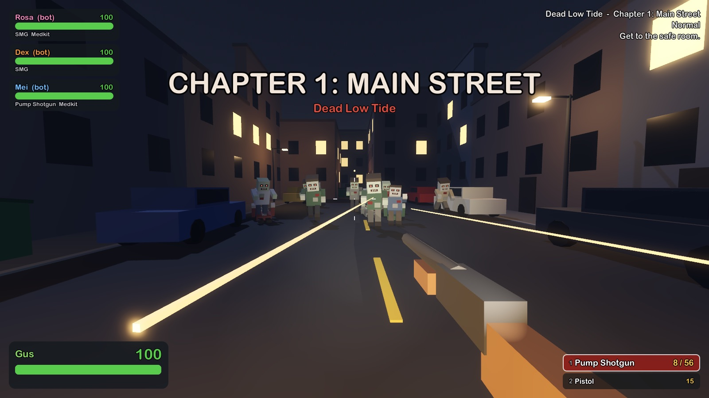
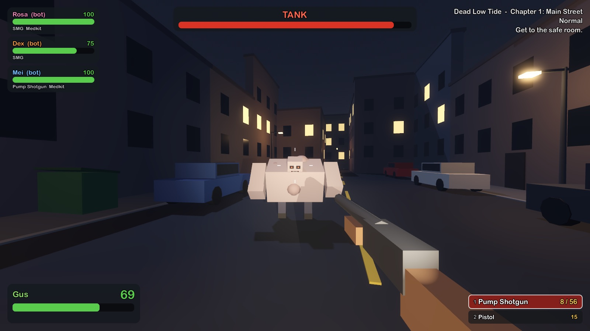
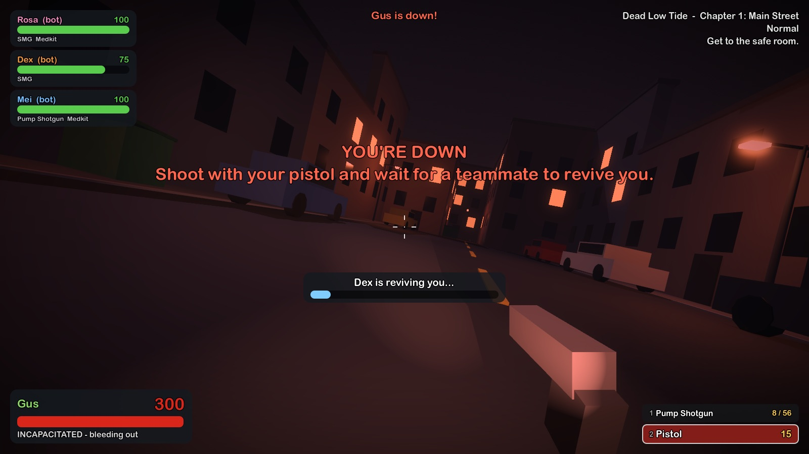
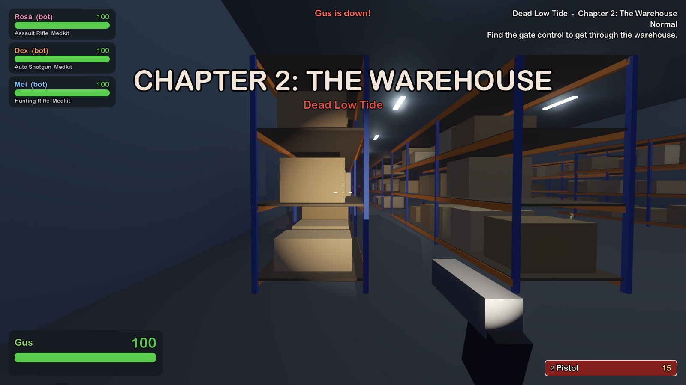
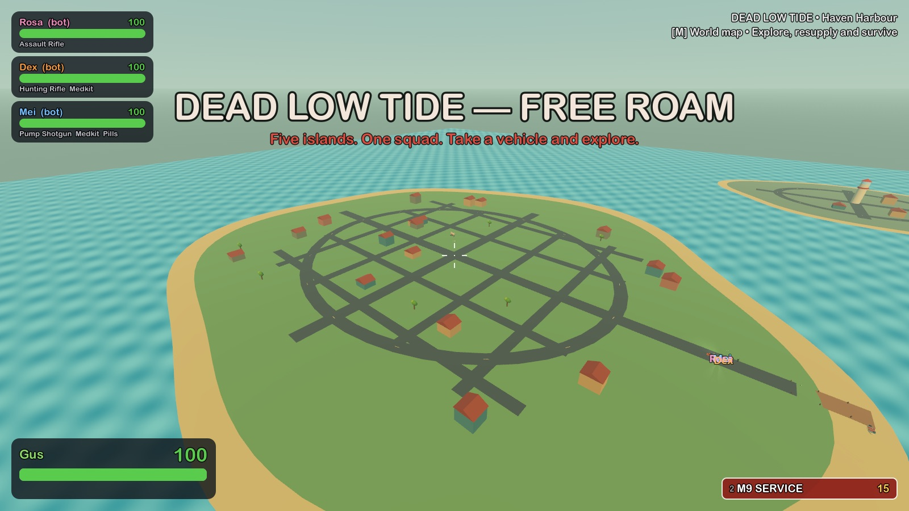
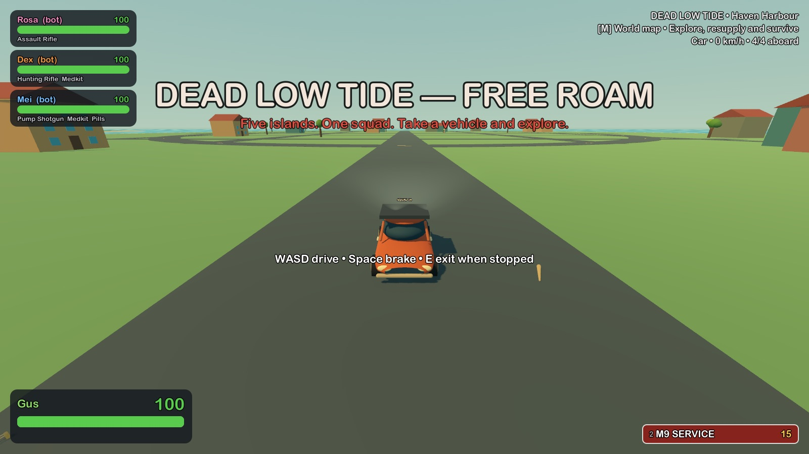
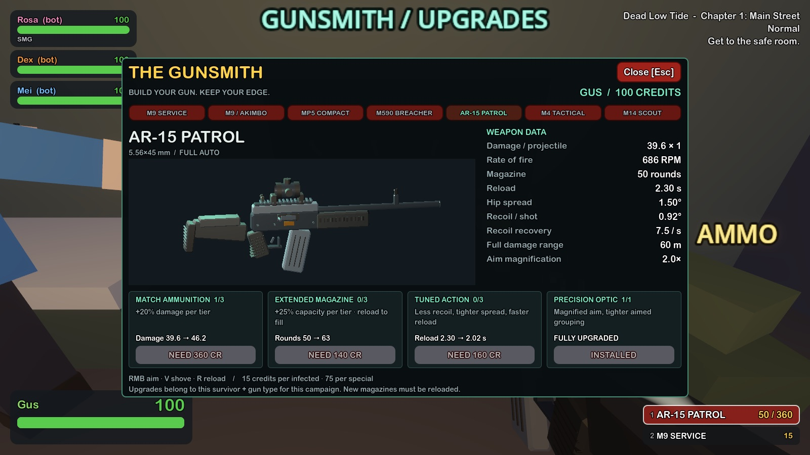
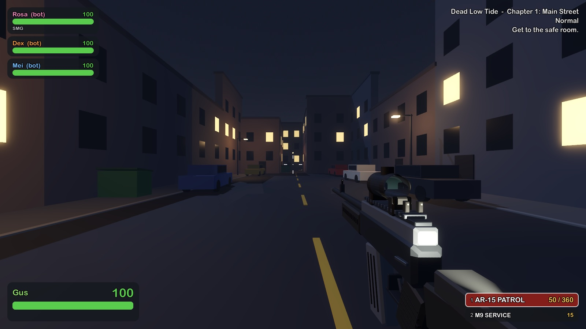

# How to Zombie

A 1–4 player co-op zombie shooter in the style of *Left 4 Dead*, with a cartoony look and realistic guns. Your squad explores an open-world archipelago by car and boat while an AI Director sends hordes and special infected wherever you go. There's also the original linear campaign, fighting from safe room to safe room. Play with friends over Steam; bots fill any empty slots.

Built with **Godot 4.7** and **GodotSteam** (Steam lobbies, invites and P2P networking through `SteamMultiplayerPeer`). There's also a LAN/IP mode for playing or testing without Steam.

| | |
|---|---|
|  |  |
|  |  |

## Free roam: the archipelago (default)

| | |
|---|---|
|  |  |

One 2.2 km map with five islands: **Haven Harbour** (town), **Rustwater Works** (industry), **Pinefall Reserve** (forest), **Sunfield County** (farmland) and **Last Light** (lighthouse). Every island has a camp with a gunsmith; camps are safe, and the Director wakes up once the team heads inland. Rustwater is Tank country.

- **Vehicles.** Five cars and five boats, shared by the team. Press **E** next to one to board (the first in drives; up to four aboard, nearby bots climb in too). **WASD** drive, **Space** brake, **E** to get out once stopped. Cars stay on land; boats carry the squad between island piers.
- **World map** (**M**): islands, camps, vehicles and teammates. Click to set a personal waypoint.

To play the original chapter-based campaign instead, launch with `--linear` (see below).

## The linear campaign: Dead Low Tide

1. **Main Street:** streets, alleys and a park. Watch out for car alarms; shooting a car with a blinking red light brings a horde.
2. **The Warehouse:** racking aisles, a loading yard, and a locked gate. Hitting the gate control starts a crescendo event: hordes pour in for 45 seconds while the shutter grinds open.
3. **The Docks (Finale):** through the shipping containers to the docks. Use the radio to call the rescue boat, then survive the waves (two Tanks included) until it arrives and get everyone to the end of the pier.

Each chapter starts and ends in a **safe room**. Get everyone inside and shut the door to finish the chapter. Your health and gear carry over; anyone who died comes back with 50 health. If the whole team goes down, the chapter restarts.

## How it plays

- **Weapons.** Everyone starts with a pistol (pick up a second for dual pistols). Safe rooms have SMGs and pump shotguns, then assault rifles, auto shotguns and hunting rifles in later chapters. Melee weapons (bat, fire axe, machete) replace your pistol. Ammo piles refill your reserve.
- **Shove** (V / right stick) knocks infected back and gets Hunters and Smokers off your teammates.
- **Health.** First aid kits heal 80% of missing health (5 seconds, hold the button; V to heal a teammate). Pain pills give temporary health that drains away.
- **Incapacitated.** At 0 health you go down and slowly bleed out, but can still shoot your pistol. A teammate holds E for 5 seconds to revive you. Go down twice and you're black and white: the next time kills you. A first aid kit resets that.
- **Throwables.** Pipe bombs beep and draw the horde in before exploding. Molotovs set the ground on fire. Bile jars make the horde attack wherever they land.
- **The infected.** Commons wander until they notice you, then sprint. Hordes come from out of sight.
  - **Boomer:** vomits on you (and explodes when shot); being covered in bile calls a horde and blurs your vision.
  - **Hunter:** pounces from a distance and pins you until someone shoves or kills it.
  - **Smoker:** drags you away with its tongue, then chokes you.
  - **Spitter:** spits pools of acid that get worse the longer you stand in them.
  - **Tank:** one per chapter. Huge health, punches send you flying, throws chunks of concrete.
  - **Witch:** sits crying in the dark. Don't shine your flashlight at her, don't get close, and don't shoot her unless you mean it.
- **The AI Director** keeps wandering infected ahead of you, sends hordes and specials from places nobody can see, drops in the Tank, and backs off for a while after big fights.
- **Bots** fill any slot without a player: they follow you, shoot, shove, revive, free pinned teammates, heal, and pick up better guns. Friends who join mid-game take over a bot.
- **Difficulty:** Easy, Normal, Advanced and Expert change common damage, special damage, friendly fire, Tank health, horde size and how often specials appear.

### Gunplay and the gunsmith

| Gun-specific upgrades | Detailed first-person weapons |
|---|---|
|  |  |

Every safe room has a physical **Gunsmith** bench. Look at it and press **E** to inspect all seven gun configurations, compare stats, and upgrade a gun you carry. Hold right mouse / LT to aim down sights; **V / R3** shoves. Guns have individual damage, fire rate, capacity, reload, spread, recoil, recovery, full-damage range, and aim magnification. Damage falls off beyond a gun's effective range, with a 25% floor. Moving and jumping widen grouping; crouching and aiming tighten it.

The semi-real platforms are the M9 Service (and akimbo pair), MP5 Compact, M590 Breacher, AR-15 Patrol, M4 Tactical and M14 Scout. These are original procedural models with bevelled receivers, 32-sided barrels, ejection ports, moving actions, triggers, sights, rails, grip texture and mixed metal/polymer/wood materials. Optics and magazine extensions appear in first and third person. Fixed geometry is combined by material and gun models are cached.

Each survivor starts a campaign with **500 credits** and earns **15 per common kill / 75 per special kill**. Purchases are validated by the host: player ownership, proximity to the bench, carried gun, funds and tier limits. Upgrades belong to that survivor and gun type throughout the campaign, including weapon swaps, chapter transitions and restarts. A new campaign resets the wallet and upgrades. They are not permanent account unlocks or transferred with dropped guns.

| Upgrade | Effect | First price / tiers |
|---|---|---|
| Match ammunition | +20% damage per tier | 180 / 3 |
| Extended magazine | +25% base capacity per tier, rounded up; reload to fill | 140 / 3 |
| Tuned action | 20% less recoil, 15% less spread, 12% faster reload per tier; faster recovery | 160 / 3 |
| Precision optic | 2× aim, or 4× on the Scout; tighter aimed grouping | 220 / 1 |

Later tiers cost the first price multiplied by the tier number. All values are game tuning, rather than manufacturer specifications. There is no cash purchase or account currency.

### Controls

| Action | Keyboard / mouse | Gamepad |
|---|---|---|
| Move / look | WASD / mouse | sticks |
| Jump, crouch, walk | Space, Ctrl, Shift | A, B, L3 |
| Fire / use item | Left click | RT |
| Aim down sights | Right click (hold) | LT (hold) |
| Shove (or heal / give pills to a teammate) | V | R3 |
| Use, pick up, open doors, hold to revive | E | X |
| Reload | R | Y |
| Inspect weapon | I | D-pad left |
| Flashlight | F | D-pad up |
| Switch slot (primary, secondary, throwable, medkit, pills) | 1–5 / wheel | LB / RB |
| Scores, pause | Tab, Esc | Back, Start |

## Running it

One setup script gets Godot 4.7+ (using a package manager you already have), downloads the GodotSteam plugin (~120 MB, gitignored) and imports the project. After that, `tools/godot` runs the game with the right Godot.

| Platform | Setup | Play |
|---|---|---|
| macOS, Linux, WSL | `tools/setup.sh` | `tools/godot` |
| Windows | `tools\setup.cmd` | `tools\godot.cmd` |
| Nix / NixOS | `nix develop`, then `tools/setup.sh` | `tools/godot`, or just `nix run` |

If Godot 4.7+ is already installed (on `PATH`, in `/Applications`, as a Flatpak, or pointed to by `GODOT=/path/to/godot`), setup uses it. Otherwise it picks the first option that fits your system and checks the version it gets:

- **Nix** (any OS with Nix): builds the Godot pinned in `flake.nix`, linked at `.tools/godot-nix`. Nothing is added to your profile.
- **macOS:** Homebrew (`brew install --cask godot`), otherwise the official download.
- **Arch, Manjaro, EndeavourOS:** `pacman`. **Fedora, Nobara:** `dnf`. **openSUSE:** `zypper`. **Void:** `xbps`.
- **Debian, Ubuntu, Mint, Pop!_OS, SteamOS and any other glibc distro:** the official Godot build, checksum-verified and put in `.tools/`. No root needed. (apt only ships old Godot, and SteamOS has a read-only root.)
- **Alpine and other musl distros:** Flatpak (`org.godotengine.Godot`).
- **Windows:** winget, then Scoop, then Chocolatey, then the official download.

You can choose explicitly, e.g. `tools/setup.sh --manager download` or `tools\setup.cmd -Manager scoop`. Use `--help` to see every option. Setup asks before running a package manager that needs `sudo`; pass `--yes` (`-Yes` on Windows) to skip the question.

**NixOS:** enable Steam with `programs.steam.enable = true;`. On x86_64, `tools/godot` runs the game inside `steam-run` so the prebuilt Steamworks libraries find a normal Linux filesystem. The dev shell provides `steam-run`; set `HTZ_NO_STEAM_RUN=1` to turn that off. If you use direnv, `.envrc` loads the dev shell automatically.

`tools/godot` passes its arguments to Godot. `tools/godot -e` opens the editor. To launch straight into a mode, put the flags after `--`:

```bash
tools/godot -- --solo                      # solo with three bots in the open world
tools/godot -- --solo --linear             # the original three-chapter campaign
tools/godot -- --solo --chapter=2 --difficulty=3   # chapter 2 on Expert (difficulty 0-3)
tools/godot -- --host                      # LAN host on port 24680
tools/godot -- --join=192.168.1.20
```

Versions are pinned in `tools/versions.env` (Godot and GodotSteam) and `flake.nix`/`flake.lock` (Nix).

## Playing with friends on Steam

1. Have the Steam client running and logged in.
2. Click **Host Steam Game**. This creates a friends-only lobby.
3. Friends can **Join Game** from your Steam profile or friends list, or you can invite them with **Pause → Invite Steam friends** (the Steam overlay invite dialog). Accepting an invite launches the game with `+connect_lobby` and joins automatically.

Friends who join take over a bot, keeping its health and gear. Up to four people can play; when someone leaves, a bot takes over again.

Every player needs a copy of the game. Right now it uses Valve's test App ID **480 (Spacewar)**, which works for development: you and your friends just need the same build. To ship it properly:

- Sign up for Steamworks, pay the Steam Direct fee, and get your own App ID.
- Change `APP_ID` in `scripts/autoload/steam_service.gd` and put the same number in `steam_appid.txt`.
- Don't ship `steam_appid.txt` in release builds. Steam provides the App ID when it launches the game.
- Export with Godot's export templates. The GodotSteam GDExtension libraries in `addons/godotsteam/` (Windows, Linux, macOS) are included automatically.

## Networking model

- **The host is the authority.** It runs the infected, the AI Director, the bots, and every health decision (damage, incaps, revives, pins). Campaign state (chapter, difficulty, stats) lives in the `Game` autoload and is pushed to clients when it changes.
- **Each player owns their own survivor.** Movement, aiming, shooting and inventory run locally so they feel instant. Hits, pickups, revives, heals, throws and door use are sent to the host as RPCs, and the host applies them.
- **Pathing:** every chapter is built on a 1 m grid. The whole horde shares one flow field (a breadth-first search out from the survivors, spread over several frames), so dozens of infected path around cars and racks for almost no cost. Bots use A* on the same grid.
- Replication uses Godot's high-level multiplayer API: a `MultiplayerSpawner` for the chapter and for each entity, and a `MultiplayerSynchronizer` on every survivor, infected and projectile. Maps are generated from a fixed seed, so every peer builds the same chapter locally. The same code runs over `SteamMultiplayerPeer`, `ENetMultiplayerPeer` or `OfflineMultiplayerPeer` (solo).

## Project layout

```
scripts/
  autoload/   settings (input map), sfx (procedural audio), steam_service, net (sessions), game_state (campaign)
  data/db.gd  all tuning: survivors, weapons, infected, difficulty, chapters, finale
  entities/   survivor, bot_brain, infected (commons + specials), projectile (throwables, hazards),
              pickup, door, character_model, item_models
  world/      level (rules, spawning, FX), director (AI Director), map_gen (chapter builder),
              nav_grid (walk grid, flow fields, A*), build (primitive helpers), water shader
  ui/         hud (+ pause, scoreboard), main_menu, ui_kit
tests/autotest.gd   scripted end-to-end tests
tools/              setup.sh / setup.ps1 (get Godot + GodotSteam), godot / godot.cmd (run the project)
flake.nix           Nix dev shell, `nix run`, pinned Godot
```

There are no imported art or audio assets. Models combine authored cross-section meshes and curved primitives, and the sound effects are synthesised at startup, so any of it can be swapped for real assets later.

## Tests

```bash
tools/godot --headless --fixed-fps 60 -- --solo --test=world          # open world: terrain, 10 vehicles, driving, boats, docking
tools/godot --headless --fixed-fps 60 -- --solo --test=world_horde    # the Director finds the team on different islands
tools/godot --headless -- --solo --test=guns       # shop interaction, wallet, upgrades, actual damage, ADS, reload, carryover
tools/godot -- --solo --test=gun_screens            # detailed gun and gunsmith screenshots in screenshots/guns/
tools/godot --headless -- --solo --linear --test=solo       # every mechanic: guns, shove, incap + bot revive, medkit, specials, throwables, Tank, Witch, wipe
tools/godot --headless -- --solo --linear --test=campaign   # all three chapters: safe rooms, gate crescendo, finale and rescue
tools/godot --headless -- --solo --linear --test=soak       # 40 s of the Director at full tilt with bots; reports frame rate
tools/godot --headless -- --test=settings          # settings screen and saved preferences

# Two-process multiplayer. Run these in real time: --fixed-fps lets the host's waits
# finish before the client has even started.
tools/godot --headless -- --host --test=world_net_host &
tools/godot --headless -- --join=127.0.0.1 --test=world_net_client                  # shared vehicles over LAN
tools/godot --headless -- --host --linear --test=net_host &
tools/godot --headless -- --join=127.0.0.1 --linear --test=net_client               # campaign replication
```

Local verification (macOS, Godot 4.7.2): all of the above pass, including both two-process LAN tests. Steam invites and P2P still need testing with two logged-in Steam clients.


### Animation captures

Weapons breathe at idle, bob with walking/running, sway with turns and strafes, dip on landing, draw on switching, and animate recoil, bolts and the shotgun pump. Hold aim to steady the movement. Press **I / D-pad left** to inspect a gun; aiming, firing, interacting or reloading interrupts inspection. Reloads move magazines, loading shells, support hands and actions. Their progress is replicated for teammates. Survivor breathing, blinking, weight shifts, hair motion, movement, healing and reviving complement the infected idles, attacks, crying, stagger and collapse. Supplies have subtle idle motion and doors ease on their hinges.

```bash
tools/godot --headless --fixed-fps 20 -- --solo --test=animation_verify
tools/godot --fixed-fps 20 --resolution 1280x720 -- --solo --test=animations
# Captures are silent and saved as unedited PNG frames in screenshots/animations/frames/.
python3 -m venv screenshots/animations/.venv
screenshots/animations/.venv/bin/pip install Pillow
screenshots/animations/.venv/bin/python tools/encode_animation_gifs.py
```

The low-frame-rate check covers input presses across multiple physics ticks, cosmetic magazine removal, ammo conservation, reload cancellation, inspection interruption and pump cycling. The ENet host/client test also checks teammate reload replication. Animation capture stages isolated actors and uses a separate camera for third-person close-ups; reloads, first aid and reviving exercise the real gameplay completion paths.

The first cartoon art slice and its shape/material rules are documented in [Art direction](docs/ART_DIRECTION.md). Run `tools/godot --fixed-fps 20 -- --solo --test=art_models` for muted model turntables, GLB exports, and in-game evidence in `screenshots/art-pass/`.
