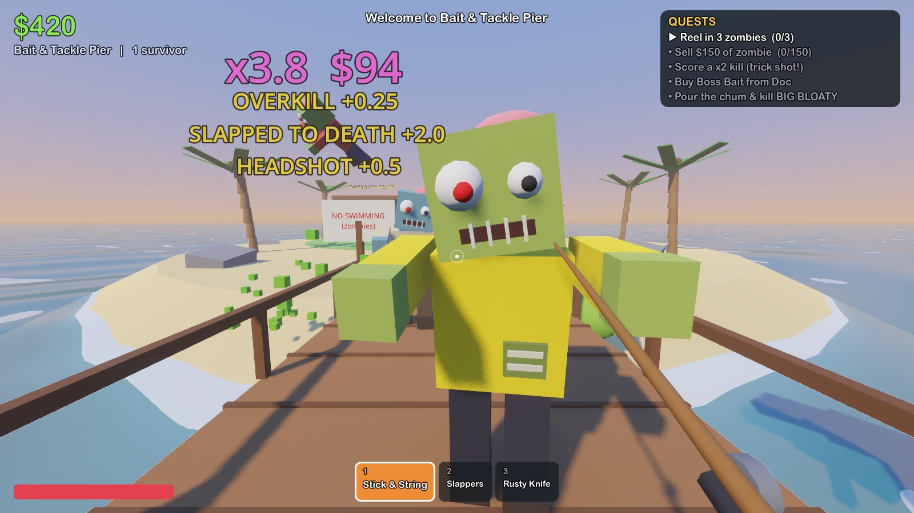
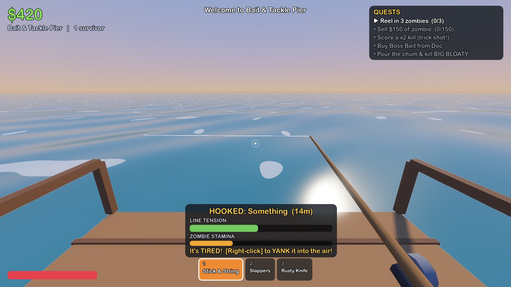
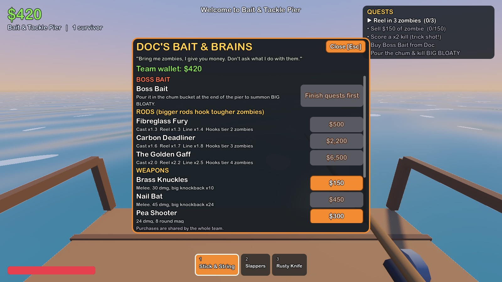

# How to Zombie

A chaotic 1–4 player co-op game in the spirit of *How to Fish*, but you're fishing zombies out of a flooded world. Cast into deep water, fight the line, yank the catch into the air, and finish it off with something stupid for a bigger kill-score multiplier. Then haul the corpse to Doc's Brain Bank, sell it, upgrade your gear, and beat each island's boss to sail on.

Built with **Godot 4.7** and **GodotSteam** (Steam lobbies, invites and P2P networking through `SteamMultiplayerPeer`). There's also a LAN/IP mode for playing or testing without Steam.

| | |
|---|---|
|  |  |
|  |  |

## The loop

1. **Fish.** Hold click to charge a cast and let go to throw. When the bobber dips, click to hook. Hold to reel and let go when it thrashes. If the tension bar fills, the line snaps.
2. **Yank.** Once the zombie is tired, right-click to launch it out of the sea in a high arc. That's your trick-shot setup.
3. **Kill with style.** Bonuses stack into a multiplier on the corpse's value: `HEADSHOT`, `AIR MAIL` (mid-air), `SLAPPED TO DEATH`, `KABOOM`, `HOME RUN`, `MULTI-KILL`, `OVERKILL`, `LONG SHOT`, `CHAIN REACTION` (bloater explosions), `DROWNED TWICE`, `SKEWERED`.
4. **Sell.** Carry (E) or throw (click) corpses into the **Brain Bank**. Or gamble one at the **Lucky Brain** slot machine for hats or a 3x jackpot. Rare Golden Boys always win.
5. **Upgrade.** Doc sells rods (better rods hook tougher zombie tiers) and weapons: knuckles, nail bat, pistol, shotgun, SMG, harpoon gun and dynamite. The whole team shares the wallet and everything you buy.
6. **Boss.** Finish the island's quests, buy Boss Bait and pour it in the chum bucket. You'll face **Big Bloaty** (spits minions, stomps), **Grill Dad** (flaming patties, calls runners) or **Mall Santa** (present bombs, elf swarms).
7. **Sail on** in the S.S. Nope: Bait & Tackle Pier → Cul-de-Sac Reef (has a trampoline) → Mega-Mall Atoll.

**Co-op:** downed players can be slapped back to life (4 slaps). If nobody gets to you, Mr. Squawks the seagull carries you back to Doc's and the team pays a hospital bill.

### Controls

| Action | Keyboard / mouse | Gamepad |
|---|---|---|
| Move / look | WASD / mouse | sticks |
| Sprint, jump | Shift, Space | L3, A |
| Use item (cast, reel, swing, shoot, throw corpse) | Left click | RT |
| Yank the catch | Right click | LT |
| Interact (shop, grab, slap, sell, boat) | E | X |
| Drop corpse, reload | Q, R | B, Y |
| Switch item | 1–0 / wheel | LB / RB |
| Scores, pause | Tab, Esc | Back, Start |

## Running it

```bash
brew install --cask godot          # Godot 4.7+
./tools/install_godotsteam.sh      # fetches the GodotSteam GDExtension (~120 MB, gitignored)
godot project.godot                # open in the editor, then press F5
```

You can launch directly into a mode (put the flags after `--`):

```bash
godot -- --solo            # solo (add --new to ignore the save)
godot -- --host            # LAN host on port 24680
godot -- --join=192.168.1.20
```

## Playing with friends on Steam

1. Have the Steam client running and logged in.
2. Click **Host Steam Game**. This creates a friends-only lobby.
3. Friends can **Join Game** from your Steam profile or friends list, or you can invite them with **Pause → Invite Steam friends** (the Steam overlay invite dialog). Accepting an invite launches the game with `+connect_lobby` and joins automatically.

Every player needs a copy of the game. Right now it uses Valve's test App ID **480 (Spacewar)**, which works for development: you and your friends just need the same build. To ship it properly:

- Sign up for Steamworks, pay the Steam Direct fee, and get your own App ID.
- Change `APP_ID` in `scripts/autoload/steam_service.gd` and put the same number in `steam_appid.txt`.
- Don't ship `steam_appid.txt` in release builds. Steam provides the App ID when it launches the game.
- Export with Godot's export templates. The GodotSteam GDExtension libraries in `addons/godotsteam/` (Windows, Linux, macOS) are included automatically.

## Networking model

- **The host is the authority.** It simulates zombies, projectiles and physics, and owns the shared state: money, unlocks, quests and boss status. That state lives in the `Game` autoload and is pushed to clients whenever it changes.
- **Each player owns their own body.** Movement, aiming, the fishing minigame and hit detection run locally so they feel instant. Hits, catches, grabs and purchases are sent to the host as RPCs, and the host applies them.
- Replication uses Godot's high-level multiplayer API: a `MultiplayerSpawner` for the island and for each entity, and a `MultiplayerSynchronizer` on every player, zombie and projectile. The same code runs over `SteamMultiplayerPeer`, `ENetMultiplayerPeer` or `OfflineMultiplayerPeer` (solo).
- People can join in the middle of a game. The host saves to `user://save.json` automatically.

## Project layout

```
scripts/
  autoload/   settings (input map), sfx (procedural audio), steam_service, net (sessions), game_state (progression)
  data/db.gd  all tuning: weapons, rods, zombies, bosses, islands, quests, bonuses, hats
  entities/   player, zombie (AI + bosses), projectile, gull, character_model, item_models
  world/      level (rules, spawning, FX), islands (layouts), build (primitive helpers), water shader
  ui/         hud (+ shop/travel/pause), main_menu, ui_kit
tests/autotest.gd   scripted end-to-end tests
```

There are no imported art or audio assets. Everything is built from primitives, and the sound effects are synthesised at startup, so any of it can be swapped for real assets later.

## Tests

```bash
godot --headless -- --solo --new --test=solo            # whole game loop: catch, kill, sell, shop, fishing, downed, boss, travel
godot --headless -- --host --new --test=net_host &
godot --headless -- --join=127.0.0.1 --test=net_client  # two-process multiplayer check
godot -- --solo --new --test=screens                    # renders screenshots/ (needs a window)
```
